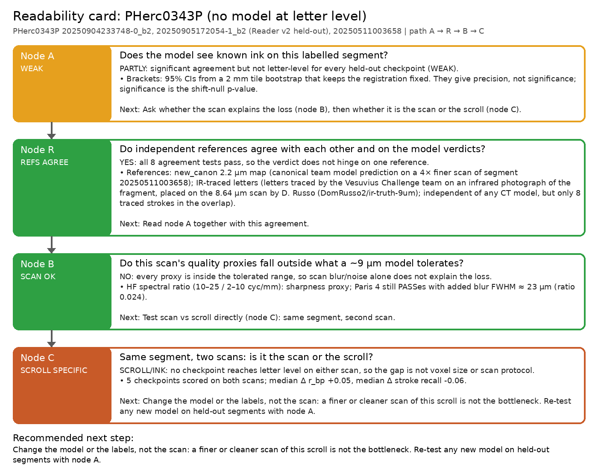
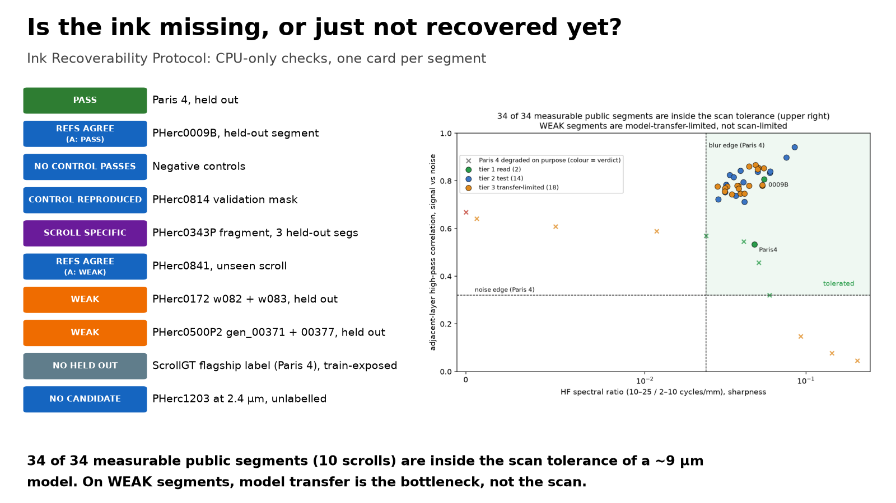
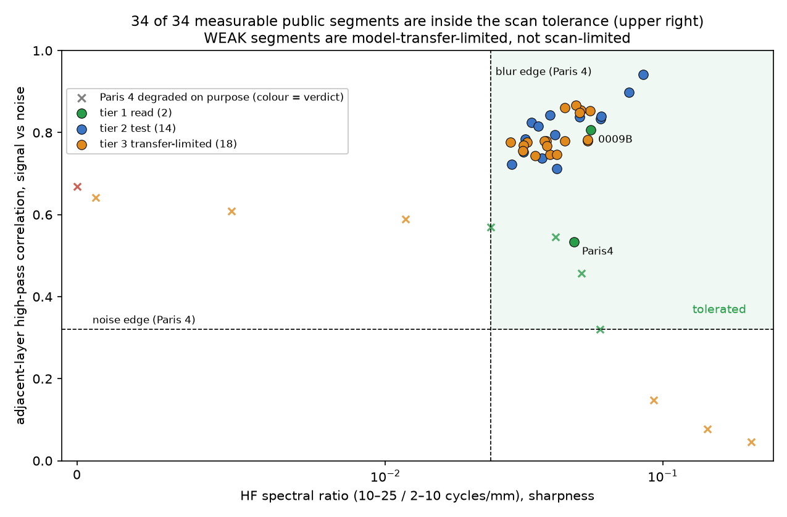
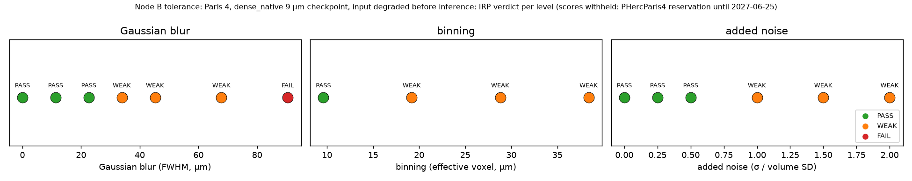

# Ink Recoverability Protocol (IRP): is the ink missing, or just not recovered yet?

[](https://github.com/dlescanogithub/vesuvius-inkcheck/actions/workflows/ci.yml)
[](https://doi.org/10.5281/zenodo.23769415)
[](https://pypi.org/project/vesuvius-inkcheck/)
[](https://colab.research.google.com/github/dlescanogithub/vesuvius-inkcheck/blob/main/notebooks/quickstart_colab.ipynb)

**IRP is a CPU-only, pre-registered decision tree for Herculaneum ink maps, built on `inkcheck`. For any segment it answers three things: does a model read the ink? If not, is the scan to blame, the scroll, or is there simply nothing to find? And what should be done next?**

The [2026 open problems](https://scrollprize.org/2026_open_problems) ask for better diagnostics and scan-quality metrics, and for a way to tell "no ink" from "no ink recovered yet". IRP is a small, testable answer. You run one command per segment, `inkcheck report case.json`, and it writes a one-page **readability card** (Markdown + PNG + JSON). The card gives the verdict at each node of the tree and the recommended next step.



## Install and first run

```bash
pip install vesuvius-inkcheck          # Python >= 3.10, CPU only; add "[zarr]" for compressed surface volumes
inkcheck --help
inkcheck quick                      # ~2 min: public PHerc0343P map vs infrared-traced letters -> PASS, wrong-place control -> FAIL
```

**5-minute tutorial:** [docs/TUTORIAL.md](docs/TUTORIAL.md) / [notebooks/tutorial_5min.ipynb](notebooks/tutorial_5min.ipynb) goes from an
**official open-data ink map** (read directly from the Vesuvius Challenge bucket with `inkcheck.opendata`: ds8 `.jpg/.png` previews,
full `.tif` maps, `layers-zarr` surface volumes) to a verdict, with one PASS-like case and one saturation WARN. Changes: [CHANGELOG.md](CHANGELOG.md).

**No install needed:** [notebooks/quickstart_colab.ipynb](notebooks/quickstart_colab.ipynb) runs `pip install vesuvius-inkcheck`, the PASS
check with its wrong-place control and the saturation warning in about 5 minutes on Colab's free CPU ([open in Colab](https://colab.research.google.com/github/dlescanogithub/vesuvius-inkcheck/blob/main/notebooks/quickstart_colab.ipynb)).

The distribution name is **`vesuvius-inkcheck`** on [PyPI](https://pypi.org/project/vesuvius-inkcheck/) (the import and the command stay `inkcheck`);
`pip install git+https://github.com/dlescanogithub/vesuvius-inkcheck` installs the development version.

### New in 0.3.0

* **Ink card** ([docs/schema.md](docs/schema.md)): every `inkcheck PRED REF` run also writes `<out>.card.json` / `.card.md`, a versioned
  (`ink-card/v1`, JSON Schema in `src/inkcheck/schemas/`) record of the verdict, numbers, nulls, wrong-place control, saturation warning
  and provenance. `inkcheck card CHECK.json --control CONTROL.json` builds one from existing outputs; `inkcheck report --validate CARD.json` checks it.
* **Docs site** (`mkdocs.yml`, `docs/`): getting started, tutorial, protocol, card schema, CI, leaderboard, reference set, API, FAQ.
  `mkdocs build --strict` builds it; `.github/workflows/docs.yml` deploys to GitHub Pages on manual dispatch or a `v*` tag.
* **GitHub Action** (`action.yml`, [docs/ci.md](docs/ci.md), example [examples/ci/model-pr.yml](examples/ci/model-pr.yml)): run inkcheck plus a
  wrong-place control on a model PR, upload the card, fail the job on FAIL (or WEAK) or on an INVALID control.
* **Public-label leaderboard** ([leaderboard/LEADERBOARD.md](leaderboard/LEADERBOARD.md)): official ds8 open-data maps scored against the public
  `ink_9um` labels, numbers only. v0 covers one official model family on 12 segments from 3 scrolls (2 PASS, 4 WEAK, 6 FAIL; mostly
  small label areas). Read its caveats: this is agreement with labels, not a held-out test.
* **Reference set v0** ([refset/REFSET_v0.md](refset/REFSET_v0.md)): 192 fixed, hashed 0.5 mm tiles (96 ink, 96 no-ink) drawn from the public
  labels on 12 segments of 3 scrolls (coordinates and hashes only, no pixels), with coverage statistics and limitations.
* **On PyPI**: `pip install vesuvius-inkcheck`; releases are published from the release workflow via a PyPI trusted publisher.

## The protocol

```
                      ┌─────────────── labelled segment? ───────────────┐
                     yes                                                no
                      │                                                  │
 A  Does the model see known ink?                     D  Does any zone meet the PRE-REGISTERED candidate rule?
    inkcheck vs search-matched shift nulls               components ≥ 2× reverse-depth null, r ≥ 0.3 with a
    PASS / WEAK / FAIL (leaked checkpoints excluded;     DIFFERENT checkpoint, strokes 0.1–0.5 mm, visual check;
    <10 strokes → compare AUC with published)            rule file hashed and timestamped before the first look
      │ PASS → stop: "readable"                            CANDIDATE → spend more (finer scan / GPU / expert)
      │ WEAK/FAIL                                          NO_CANDIDATE → extra compute not justified
      ▼                                                    EXPLORATORY → rule not shown to come first
 B  Do the scan's quality proxies fall outside what a ~9 µm model tolerates?
    HF spectral ratio, adjacent-layer HP correlation vs the worst PASS on a labelled dose-response
      │ SCAN_SUSPECT → rescan / denoise / higher-res model          SCAN_OK ↓
      ▼
 C  Same segment, two scans: does any checkpoint PASS on one scan but not the other?
      SCAN_LIMITED → a better scan helps      SCROLL_SPECIFIC → change the model or labels, not the scan
```

| node | question | automated by `inkcheck report` | manual input |
|---|---|---|---|
| A | does the model see known ink? | verdict per checkpoint, leak exclusion, low-power AUC control; can run inkcheck itself from `pred`/`ref` paths | the inference run (`bench/score.py`) |
| R | does the verdict survive a second, independent reference? | `same_pred` pairs: the same prediction scored against e.g. a team map and human labels; REFS_AGREE / REFS_PARTIAL / REFS_DISAGREE | a second reference of the same segment |
| N | do negative controls fail as they must? | wrong region, phase-randomised, tile-shuffled (± rotation) predictions; NO_CONTROL_PASSES if none reaches PASS | building the controls (`examples/irp/negative_controls.case.json`) |
| B | does the scan explain the loss? | tolerance edge from the curve, placement of the target scan | measuring the proxies (`study/psd_compare.py`, `study/layer_snr.py`) and the degradation runs (`study/make_degraded_p4*.py`, `study/run_ablation.sh`); done once per reference model |
| C | scan or scroll? | per-checkpoint comparison of the two scans | rendering the segment from the second scan |
| D | candidate on an unlabelled segment? | candidate rule, sha256 of the prereg file, timestamp order | writing the rule **first** ([PREREG_TEMPLATE.md](PREREG_TEMPLATE.md)), the visual stroke check, the zone numbers (`examples/irp/export_1203.py` shows one way) |

Once the inkcheck JSONs exist, each card takes < 1 s. All verdict thresholds are fixed in `src/inkcheck/irp.py` and quoted on the card. The reference maps are themselves model outputs or annotations, so PASS means "agrees with the community read", not ground truth.

## Worked examples: 10 cards in `cards/`

| card | path | verdict | bottom line |
|---|---|---|---|
| [Paris 4 (held out)](cards/paris4.md) | A | **PASS** | 5 of 5 held-out checkpoints recover letters, Reader v2/V3 included (scores withheld: PHercParis4 reservation until 2027-06-25) |
| [Negative controls](cards/negative_controls.md) | A → N | **NO_CONTROL_PASSES** | wrong region, phase-randomised and shuffled+rotated tiles FAIL; a plain tile shuffle is WEAK (text-line layout survives, r 0.15) but its stroke recall is at chance, so no control PASSes |
| [PHerc0009B](cards/pherc0009B.md) | A → R | **REFS_AGREE** (A: PASS) | Reader V3 (r 0.79, stroke recall 0.59 vs 0.17 chance), Reader v2 (r 0.75, 0.59) and dense_native (r 0.67, 0.54) PASS against the team 2.4 µm map, and the independent human labels agree (r 0.69 / 0.65 / 0.58, 10 of 10 strokes) |
| [PHerc0814 validation mask](cards/pherc0814.md) | A | **CONTROL_REPRODUCED** | inkcheck's AUC matches the published AUC within 0.02 for 4 of 4 checkpoints, so the scoring agrees with the official evaluation |
| [PHerc0343P](cards/343P.md) (fragment, 3 segments) | A → R → B → C | **SCROLL_SPECIFIC** (these segments) | On these 3 fragment segments no held-out checkpoint reaches letter level (WEAK; seed42 FAIL), and that includes Reader v2/V3 on their own held-out segments. The scan is inside the tolerated blur/noise range, and the 4× finer 2.2 µm scan of the same segment does not fix it. Not a verdict on the rolled PHerc. 343, where the same public models read letters ([Nieuwlaar, Oct 2026](https://github.com/Nieuwlaar/pherc343-first-letters)) |
| [PHerc0841 (unseen scroll)](cards/pherc0841.md) | A → R | **REFS_AGREE** (A: WEAK) | Reader V3 / Reader v2 / dense_native are significant against the 2.4 µm map (best r 0.55, stroke recall 0.34 vs 0.15 chance) but below letter level; against the 7-stroke human labels r is significant (0.30 / 0.23 / 0.18) with 0, 1 and 0 of 7 strokes, so both references say WEAK |
| [PHerc0172 w082 + w083](cards/pherc0172.md) | A | **WEAK** | Two held-out segments (w082 / w083). Reader V3: r 0.45 / 0.51, stroke recall 0.35 / 0.36 vs 0.20 / 0.19 chance; Reader v2: r 0.47 / 0.50, 0.37 / 0.35; dense_native: r 0.34 / 0.26, 0.23 / 0.21 |
| [PHerc0500P2 gen_00371 + gen_00377](cards/pherc0500P2.md) | A | **WEAK** | Two held-out segments (371 / 377). Reader V3: r 0.44 / 0.33, stroke recall 0.32 / 0.17 vs 0.07 / 0.06 chance; Reader v2: r 0.42 / 0.30, 0.27 / 0.16; dense_native: r 0.30 / 0.21, 0.16 / 0.10 |
| [ScrollGT flagship label (Paris 4)](cards/scrollgt_flagship.md) | A | **NO_HELD_OUT** | Reader V3 and seed42 PASS against ScrollGT's human label, but the segment is in their training data, so IRP excludes both (scores withheld: Paris 4 segment). See [ScrollGT](#scrollgt-adapter-ap-prevalence-lift) |
| [PHerc1203 at 2.4 µm](cards/pherc1203.md) (unlabelled) | D | **NO_CANDIDATE** | 0 of 19 zone/model pairs meet the pre-registered rule, so this evidence does not justify a GPU pass. Caveat: the same rule also returns NOTHING on the PHerc. 343 region where letters were read (see below), so NO_CANDIDATE is weak evidence of absence |

```bash
inkcheck report examples/irp/*.case.json --out cards     # regenerates all ten cards (paths in the case files are relative)
```

Held-out status is recorded per check (`held_out`). Checks on training segments are shown on the card but never decide the verdict; if no check is held out, the card says NO_HELD_OUT. The `ink_9um` labels cover PHerc0139, 1667, Paris 4 and 0814 only, so dense_native and seed42 are held out on 0009B, 0841, 0172 and 0500P2. Reader V3's training list is in `triage/reader_v3_train_segments.json`.

A one-page summary of all of this is in [`docs/IRP_onepager.pdf`](docs/IRP_onepager.pdf) (regenerate with `python docs/make_onepager.py`; every number is read from `cards/*.json`, `calibration/calibration.json` and `triage/triage_summary.json`).



A case file lists the inkcheck JSONs (or `pred`/`ref` so the report can run them), the proxy numbers and tolerance curve, the two-scan pair and/or the `unlabeled` block. See `examples/irp/*.case.json`.

A naive global r ≈ 0.40 (z ≈ 8.6) on 343P looks like a success. Node A is what separates it from a readable segment:

| dense_native 16k, held out | r_bp | raw r | stroke recall (chance) | verdict |
|---|---|---|---|---|
| Paris 4 20231005123336 (9.6 µm) | withheld | withheld | withheld | **PASS** |
| PHerc0343P 20250511003658 (native 8.64 µm) | 0.277 | 0.40 | 0.16 (0.06) | WEAK |

Paris 4 scores are withheld while the PHercParis4 publication reservation applies (until 2027-06-25); see [Data and licensing](#data-and-licensing).

The side-by-side panels (prediction, registered reference, overlay, null histogram) are not shipped because they show scroll ink maps (see [Data and licensing](#data-and-licensing)). `inkcheck` draws the same panels in `out/<name>.png` when you run it on fetched data.

> **Scope.** These cards are diagnostics, not a ranking. The small [public-label leaderboard](leaderboard/LEADERBOARD.md) only reports how official maps agree with the public labels; for ranking many readers across benchmarks, use [inkbench](https://github.com/inksweep/inkbench). See [Related work](#related-work).

## Quickstart (5 minutes, CPU): see [QUICKSTART.md](QUICKSTART.md)

One command, real data fetched at run time (about 2 minutes on 2 CPU threads): `pip install -e . && inkcheck quick` prints PASS / WEAK / FAIL for a public PHerc0343P segment against infrared-traced letters, with the numbers, a wrong-place control and a plain-English explanation.

```bash
pip install -e .
python examples/make_synthetic_example.py          # data-free stroke maps (seconds)
inkcheck examples/data/synthetic_pred_9.6um.png examples/data/synthetic_ref_19.2um.png \
  --pred-um 9.6 --ref-um 19.2 --ref-origin 128,128 --workers 2 --out out/synthetic   # PASS, r_bp 0.67
inkcheck report examples/irp/paris4.case.json --out out/cards                      # IRP card (Paris 4: verdicts only)

# Real data (Paris 4), fetched from the public Vesuvius Challenge bucket; not stored in this repo:
python examples/fetch_paris4_example.py            # reference crop; add --with-pred to rebuild the prediction
inkcheck examples/data/paris4_dn_pred_9.6um.png examples/data/paris4_ref_crop_19.2um.png \
  --pred-um 9.6 --ref-um 19.2 --ref-origin 256,256 --workers 2 --out out/paris4    # PASS (scores stay on your machine)
```

- Exit code: 0 = PASS, 1 = WEAK, 2 = FAIL.
- `PRED` is your model's 2D ink map; `REF` is a published ink map of the **same segment**. They may be at different pixel sizes.
- If the prediction is a crop, use `--ref-origin y,x` (in reference pixels).
- Other ways to run it:
  - Notebook: `notebooks/quickstart.ipynb`.
  - Docker: `Dockerfile`.
  - CI: `.github/workflows/ci.yml` runs the tests (CPU, offline: `-m "not network"`) plus this example.
- Tests: `cd tests && python -m pytest -q -m "not network"`, or `python -m unittest discover -s tests` with `src` on PYTHONPATH.

## Calibration: are the PASS thresholds right? (`calibration/`)

`python calibration/calibrate.py` re-reads every inkcheck JSON in `results/` and checks the shipped rule (PASS = p(r) ≤ 0.01, p(stroke recall) ≤ 0.05, r_bp ≥ 0.20, stroke recall ≥ 0.50) against labelled groups. Every check carries a 2 mm tile-bootstrap 95 % CI.

| group | n | result |
|---|---|---|
| readable (held-out PASS cases: Paris 4 ×5, 0009B ×6) | 11 | 11 of 11 PASS; lowest r_bp 0.575 (0009B human labels, dense_native, CI 0.52–0.62) |
| negative controls | 4 | 0 of 4 PASS; highest r_bp 0.152 (tile shuffle, WEAK, stroke recall at chance) |
| shift nulls | 9792 draws | max r_bp 0.157, 99th percentile 0.102 |
| r_bp as a readable-vs-control classifier | | ROC AUC 1.0; at r_bp ≥ 0.20: TPR 1.0, FPR 0.0 |

Threshold sensitivity: moving the r threshold anywhere in 0.10–0.30 changes no recorded verdict. The stroke-recall threshold is the one that matters: 0.40 changes 2 verdicts, 0.30 changes 9 and 0.60 changes 7; no control passes at any of these settings. The rule reproduces every recorded verdict. The thresholds were fixed on synthetic tests before real data and were not re-tuned here. Plot: `calibration/calibration.png`. The Paris 4 cases are counted in every aggregate above but are listed by verdict only in `calibration.json` and are not plotted; `calibrate.py` needs the private Paris 4 JSONs (`INKCHECK_PRIVATE_RESULTS`) to reproduce these aggregates exactly, and otherwise writes `calibration_public_only.*`.

## Triage: where is GPU time worth it? (`triage/`)

**34 of 34 measurable public segments (10 scrolls) are inside the scan tolerance of a ~9 µm model. On the segments where models are WEAK, model transfer is the bottleneck, not the scan.** A WEAK verdict is per segment, not per scroll (see the PHerc. 343 note below). Tiers: 2 read, 14 test, 18 transfer-limited, 0 scan-limited, 1 not measured (too little valid surface). Tolerance (node B, Paris 4 dense_native verdicts per degradation level, `figures/tolerance_curve.png`): voxel ≤ 9.6 µm, HF spectral ratio ≥ 0.024, adjacent-layer high-pass correlation ≥ 0.32. Rules, per-segment table and caveats: [`triage/TRIAGE.md`](triage/TRIAGE.md).



## ScrollGT adapter: AP-prevalence-lift (`examples/scrollgt/`)

[ScrollGT](https://github.com/jonmarrs/scrollgt) (v0.9.1, MIT; README as of ad8a972, 2026-10-27) provides registered human ink labels and reports AP-prevalence-lift (AP / positive rate; 1 = all-positive, 1/prevalence = oracle). `inkcheck.scrollgt` computes the same metric; `tests/test_scrollgt.py` checks it against scikit-learn. On a 2048² sub-crop of ScrollGT's flagship region (Paris 4 segment 20231210121321, 2.4 µm scan pooled ×4), Reader V3 and ink_9um seed42 both PASS against ScrollGT's label, and both find the same registration offset between the label and the segment, consistent with the ~0.31 mm placement uncertainty ScrollGT states for this target (so scores against ScrollGT as placed are lower bounds). The scores (r_bp, stroke recall, AP-lift) are withheld because this is a PHercParis4 segment (publication reservation until 2027-06-25).

| checkpoint | IRP verdict |
|---|---|
| Reader V3 | PASS, **train-exposed** |
| ink_9um seed42 | PASS, **train-exposed** |

What this does and does not show:
- 20231210121321 is `ink_9um` phercparis4-w06, in the training configs of Reader V3, seed42 and dense_native, so IRP correctly returns **NO_HELD_OUT**: this is a demonstration of the leakage guard, not held-out validation. ScrollGT's other public target (20230702185753, w01) is also train-exposed and is non-scoring in ScrollGT.
- Our sub-crop scores (withheld) are not comparable with ScrollGT's `BASELINES.md` (different crop, subsampled pixels).
- ScrollGT's earlier near-chance flagship numbers (ROC-AUC ≈ 0.55–0.56) were retracted by ScrollGT itself (revision of 2026-08-07, a LEVEL0_SHAPE registration bug; credited to erdpx, villa #1280). ScrollGT v0.9.1 (0f3fa90, 2026-10-27; wording clarified in 32deb61) states that the held-out claim refers to its own distilled students: arm B and arm C never trained on the flagship segment and read it at ROC-AUC 0.731 / 0.746 (AP-lift 2.34 / 2.44); the released canon teacher scores 0.753 (AP-lift 2.15). We quote ScrollGT's numbers from its README and did not re-run its pipeline.
- This is consistent with our NO_HELD_OUT card: "held out" in ScrollGT means held out from ScrollGT's students. The train-exposed checkpoints are ours (Reader V3, ink_9um seed42; dense_native too), whose public training configs include this segment as phercparis4-w06. ScrollGT's leaderboard line "no public model we know of trained here" does not cover these public 9 µm checkpoints.

Reproduce: `examples/scrollgt/fetch_flagship.py` (downloads the crop), `examples/scrollgt/run_flagship.sh`, `examples/scrollgt/ap_lift.py` → `results/scrollgt/ap_lift.json` (written locally; not shipped).

## Why

A global Pearson r between a prediction and a reference looks convincing far too easily:
- both maps share the papyrus and sheet-coverage trend, so a model that just lights up where papyrus is thick gets r ≈ 0.3–0.4;
- inkcheck removes that trend, searches the registration honestly, and compares every number against a null distribution that went through *the same* search;
- it then asks the reader's question: **are the reference strokes there?**

## The evidence behind the cards: Paris 4 vs PHerc0343P (all CPU)

Raw JSON for every row is in `results/`, except the Paris 4 rows (scores withheld, PHercParis4 reservation until 2027-06-25). Segment 20250511003658 is in the training labels of Reader v2/V3, and these rows cover only the five checkpoints listed. Those readers are scored on their held-out 343P segments in the next subsection.

| Segment (reference) | Input | Model | r_bp (null) | raw r | AUC | breakeven F1 (null) | stroke recall (null) | verdict |
|---|---|---|---|---|---|---|---|---|
| Paris 4 20231005123336, held out (new_canon) | 9.6 µm pooled from 2.4 µm scan | ink_9um seed42 | withheld | withheld | withheld | withheld | withheld | **PASS** |
| same | same | dense_native 16k | withheld | withheld | withheld | withheld | withheld | **PASS** |
| PHerc0343P 20250511003658 (new_canon, 2.215 µm) | native 8.64 µm / 116 keV render | dense_native 16k | 0.277 (0.05±0.02) | 0.40 | 0.77 | 0.31 (0.12) | 0.16 (0.06) | WEAK |
| same | same | dense9um (Klavis) | 0.257 | 0.37 | 0.75 | 0.30 | 0.18 (0.06) | WEAK |
| same | same | ink_9um seed42 | 0.152 | 0.20 | 0.63 | 0.21 | 0.19 (0.09) | WEAK |
| same | same | ink_9um seed43 | 0.162 | 0.21 | 0.65 | 0.21 | 0.12 (0.07) | WEAK |
| same | same | soup (Erwin) | 0.178 | 0.23 | 0.66 | 0.23 | 0.14 (0.08) | WEAK |
| same | **2.215 µm / 111 keV surface volume pooled to 8.86 µm** (same segment, other scan) | dense_native 16k | 0.396 (0.05) | 0.43 | 0.80 | 0.37 | 0.15 (0.06) | WEAK |
| same | same | dense9um (Klavis) | 0.389 | 0.41 | 0.81 | 0.36 | 0.22 (0.06) | WEAK |
| same | same | ink_9um seed42 / seed43 / soup | 0.19 / 0.19 / 0.23 | 0.17–0.24 | 0.64–0.67 | 0.21–0.24 | 0.05–0.07 (0.06) | WEAK |

**Reading:**
- The checkpoints that PASS on Paris 4 (letter level) recover only 12–19 % of 343P strokes on the native 8.64 µm scan. That is significantly above chance, but not readable.
- Rendering the same 343P segment from the 2.2 µm scan and pooling it to ~9 µm does not fix it.

### Reader v2 / V3 on their held-out 343P segments

Reader v2 and V3 (Domenico Russo) and d9v4C (TAUIL Abd Elilah, fine-tuned from Reader v2) are scored with the same check. They run on the two PHerc0343P segments that Reader v2's own selection holds out (`20250904233748-0_b2` and `20250905172054-1_b2`, from `results/040000.json` in the reader-v2 repo), plus Paris 4. Input is the official native 8.64 µm / 116 keV surface volume. The reference is the team's 2.215 µm new_canon map, and the mask covers papyrus (layer 15 > 0). Inference uses the team's `ink_9um` CLI with 17 centred layers in forward order, on CPU. Weights come from the authors' public Hugging Face and GitHub releases (MIT). The published Reader v2 AUC for each segment is shown in brackets as a cross-check. **Leakage:** both 343P segments are in d9v4C's `train.txt`, so its 343P rows are *not* held out. Paris 4 w04/w08 are absent from all of these training lists. Raw JSON: `results/reader_v2/` (Paris 4 rows: verdict only).

<!-- READERV2_ROWS -->
| segment | checkpoint | verdict | r_bp (z) | AUC (Reader v2 published) | stroke recall (chance) | area cm² | note |
|---|---|---|---|---|---|---|---|
| paris4-20231005123336 | rv2 | **PASS** | withheld | withheld | withheld | withheld |  |
| paris4-20231005123336 | rv3 | **PASS** | withheld | withheld | withheld | withheld |  |
| paris4-20231005123336 | d9v4C | **PASS** | withheld | withheld | withheld | withheld |  |
| paris4-20231005123336 | s42 | **PASS** | withheld | withheld | withheld | withheld |  |
| paris4-20231005123336 | dn | **PASS** | withheld | withheld | withheld | withheld |  |
| 343P-20250904233748 | rv2 | **WEAK** | 0.183 (8.4) | 0.759 (0.806) | 0.12 (0.07) | 4.29 |  |
| 343P-20250904233748 | rv3 | **WEAK** | 0.219 (9.5) | 0.776 | 0.17 (0.08) | 4.30 |  |
| 343P-20250904233748 | d9v4C | **WEAK** | 0.214 (12.4) | 0.748 | 0.11 (0.06) | 4.30 | LEAK:segment_in_d9v4C_train.txt |
| 343P-20250904233748 | s42 | **FAIL** | 0.047 (0.6) | 0.617 | 0.04 (0.07) | 4.27 |  |
| 343P-20250904233748 | dn | **WEAK** | 0.092 (3.6) | 0.708 | 0.09 (0.08) | 4.28 |  |
| 343P-20250905172054 | rv2 | **WEAK** | 0.196 (7.6) | 0.692 (0.728) | 0.18 (0.07) | 3.23 |  |
| 343P-20250905172054 | rv3 | **WEAK** | 0.193 (6.3) | 0.690 | 0.16 (0.06) | 3.22 |  |
| 343P-20250905172054 | d9v4C | **WEAK** | 0.219 (10.1) | 0.714 | 0.12 (0.06) | 3.22 | LEAK:segment_in_d9v4C_train.txt |
| 343P-20250905172054 | s42 | **FAIL** | 0.059 (0.5) | 0.545 | 0.07 (0.06) | 3.22 |  |
| 343P-20250905172054 | dn | **WEAK** | 0.121 (4.0) | 0.639 | 0.11 (0.06) | 3.22 |  |

*Status: all runs finished. Verdict rule as above; AUC in brackets = Reader v2's own published `auc_map` for that segment.*
<!-- /READERV2_ROWS -->

### Sanity check: inkcheck agrees with the published held-out numbers

<!-- VALMASK_ROWS -->
Before trusting the diagnostic, check that it measures the same thing as the official evaluation. Same crops and held-out pixels as the `ink_9um` validation masks (`bench/fetch_ink9um_val.py`); predictions from villa inference on CPU (`bench/score.py`, layers 2–19, one z window); AUC over held-out pixels only.

| segment (held-out px) | checkpoint | inkcheck AUC | published AUC | Δ | r_bp | strokes recalled | verdict |
|---|---|---|---|---|---|---|---|
| pherc0139-w016 | ink_9um seed42 75k | 0.883 | 0.774 | +0.109 | 0.54 | 1.00 of 2 | FAIL |
| pherc0814-46527 | Erwin dense_native 16k | 0.932 | – | – | 0.66 | 1.00 of 2 | WEAK |
| pherc0814-46527 | dense9um all7 | 0.939 | 0.935 | +0.004 | 0.67 | 1.00 of 2 | WEAK |
| pherc0814-46527 | dense9um w016-excluded | 0.930 | 0.930 | +0.000 | 0.64 | 1.00 of 2 | WEAK |
| pherc0814-46527 | ink_9um seed42 75k | 0.884 | 0.874 | +0.009 | 0.58 | 1.00 of 2 | WEAK |
| pherc0814-46527 | ink_9um seed43 75k | 0.858 | – | – | 0.49 | 0.50 of 2 | WEAK |
| pherc0814-46527 | Erwin soup42_last4 | 0.870 | 0.881 | -0.011 | 0.57 | 1.00 of 2 | WEAK |
| pherc1667-w029 | ink_9um seed42 75k | 0.917 | 0.870 | +0.047 | 0.57 | 1.00 of 3 | FAIL |

Published AUCs used other z-window choices, so differences of about ±0.01–0.02 are expected. The label crops hold only a few strokes each, so the stroke test has almost no power here (verdicts are WEAK at best): on these masks AUC is the number to compare, and the PASS/WEAK verdict is meant for full segments.
<!-- /VALMASK_ROWS -->

## Diagnostics: scan quality, resolution, scan vs scroll (`docs/RESOLUTION_STUDY.md`)



- **Paris 4 dose-response (dense_native):**
  - letters survive an added XY blur of FWHM ≈ 23 µm (PASS);
  - they degrade from ≈ 34 µm and are gone by ≈ 68 µm;
  - 19.2 µm sampling already drops the verdict to WEAK;
  - noise of 0.5× the volume SD is tolerated (PASS); at 1× the SD the verdict drops to WEAK.
  - (verdicts only; the Paris 4 scores are withheld until 2027-06-25)
- **343P's native scan is not blurrier or noisier than the Paris 4 input** by spectral and inter-layer proxies.
- **Stroke size is similar** in both references (343P median ≈ 0.19 mm²; Paris 4 value withheld).
- **Same segment, other scan:** the 2.215 µm / 111 keV surface volume pooled to 8.86 µm gives 7 of 7 runs WEAK.
  - So on these fragment segments the gap is **segment- or ink-specific**, not voxel size.
  - It does not generalize to the whole object: on the rolled PHerc. 343 (scan 20250509220833, windings w047/w048, z 9500–11000; no overlap with our fragment scans) an average of the same public 9 µm models reads letters (E. Nieuwlaar, $50K First Letters Prize, Oct 2026, [repo](https://github.com/Nieuwlaar/pherc343-first-letters)).
  - Validate each region on a labelled segment (node A) before trusting ~9 µm maps; one WEAK region says little about another.
- **Unlabelled PHerc0800/1203:** depth-order nulls keep most of the map texture, so we claim no ink there.

### PHerc1203 at 2.4 µm: does 4× finer voxels change anything on an unread scroll? (pre-registered)

Three PHerc1203 zones are rendered from the 2.403 µm scan and compared with the 9.362 µm prediction of the same area. The zones and the "candidate" rule (density ≥ 2× a depth-reversed null, checkpoint agreement, stroke-sized shapes) were fixed before any 2.4 µm data was viewed. No zone will be called "ink", because 1203 has no reference. See `docs/RESOLUTION_STUDY.md` for the design.

<!-- HIRES_1203_RESULTS: filled by study/fill_hires.py from the hires run's summary.json -->
**Result (IRP node D, [card](cards/pherc1203.md)): NO_CANDIDATE.** None of the 19 zone/model pairs (13 from the first three zones: hecate at native 2.4 µm, dense_native at 2.4 and 9.6 µm; 6 from the phase-3 tiles, hecate only) has components ≥ 2× its reverse-depth null together with r ≥ 0.3 against a different checkpoint. The rule file (`results/irp/1203_PREREG.md`) was written before the first output. The phase-4 run (48 more tiles) started Oct 28, 00:21 ART and was still running when this was committed; its tiles will be added the same way.
<!-- /HIRES_1203_RESULTS -->

### PHerc. 343 (rolled), the First Letters region: does IRP node D find what was read? (pre-registered)

E. Nieuwlaar won the First Letters Prize (Oct 2026) on the still-rolled PHerc. 343 (scan 20250509220833, 8.64 µm; windings w047/w048 joined; z 9500–11000) with an average of four public 9 µm models (ink_9um seed42/43, dense_native, hecate), none trained on 343 ([repo](https://github.com/Nieuwlaar/pherc343-first-letters)). This is a different object, scan and region from our PHerc0343P fragment segments; nothing overlaps.

We re-rendered his region on CPU and ran the node D rule unchanged, written down before the first render (`results/irp/pherc343_erwin/PREREG.md`, sha256 `4a1ba702…`, 2026-10-28 10:22 ART; render finished 10:24 ART). There is no independent reference (his letter boxes were drawn while looking at the ensemble), so node A cannot run.

- **Node D: NOTHING (0 of 3 checkpoints pass).** The three villa checkpoints agree with each other (pairwise r 0.60–0.62 on the reading side), have plausible stroke widths (median 230–330 µm) and enough components (56–87 over 4.3 cm²), but stroke-sized components on the reading side are only 0.99–1.26× the depth-reversed null, below the 2× threshold. Hecate was still running when this was written; it cannot change the verdict, because criterion (i) fails for all three villa models on its own.
- **So node D has a false negative on a region with letters a human expert read.** In a tightly rolled scroll the depth-reversed side faces the neighbouring winding, which can carry ink too, so the ratio test is conservative. Read the PHerc1203 NO_CANDIDATE above with that in mind.
- **Secondary, circular (labelled so in the prereg):** inside his letter boxes vs outside, AUC on the reading side is 0.62–0.65 per model and 0.67 for the 3-model z-score average (2000 random box translations, p ≤ 0.001); on the blind side it is 0.46–0.50. CONSISTENT with his read, but the boxes were placed by looking at this kind of map, so this is not independent confirmation.
- Deviations: no tile-phase averaging (his `pad_render` trick); dense_native weights are tensor-identical to the public safetensors. Numbers only: `results/irp/pherc343_erwin/RESULTS_villa3.json`; no renders or maps are published (CC BY-NC data).

### Node D v2 (off-winding control): a pre-registered negative, and the face-only option

Node D v2 (`results/irp/node_d_v2/`, prereg sha256 `1bc3423e…`) added a spatial null and an off-winding control (surface moved ±P/2) on 12 known-ink and 4 blank regions from 6 held-out open-data segments. **It was REJECTED: 1 of 12 positives.** The ±P/2 surface is not ink-free on these segments (two-model agreement there is about as high as on the surface). The face-asymmetry statistic from [villa #2318](https://github.com/ScrollPrize/villa/pull/2318) (`face_check`, ketchupbyheinz), tracked as a descriptive column, flagged 9 of 12 positives in 5 of 6 segments and 0 of 4 blanks (only one blank had CT data), but also 2 of 24 synthetic controls (`results_v2_rescored.json`).

Face-only is now available as `rule_type: "face_only"` in node D (v1 stays the default). Its rule is pre-registered in `results/irp/node_d_faceonly/PREREG_NODE_D_FACEONLY.md` (sha256 `ba553d03…`, credit #2318). **Validation on fresh data (set F1): REJECTED.** On 6 independent open-data segments picked mechanically from the bucket listing (one per scroll; listing, tiles, scorer committed before inference), face-only flagged 4 of 12 known-ink tiles in 3 of 6 segments (the prereg needs 8 and 4); 0 of 24 synthetic controls; 1 of 2 blanks (too few blanks to test specificity). v1 stays the default. Numbers: `results/irp/node_d_faceonly/f1/RESULTS.md`. **Specificity set F2: SPECIFICITY_FAILED.** A second pre-registered set (prereg `f2/PREREG_F2.md`, sha256 `a92e1169…`; 8 blanks = tiles ≥ 1 mm from reference ink, 30 known-ink tiles, 15 segments) flagged 3 of 8 blanks (allowed 1), 10 of 30 known-ink tiles and 2 + 2 of 60 controls. So a face-only FLAG is not evidence of ink on public segments; it stays a research option. Caveat: all 8 blanks are on PHerc0139 and "blank" means "no ink in the reference map". Numbers: `results/irp/node_d_faceonly/f2/RESULTS.md`.

`docs/CPU_INFERENCE.md` gives about 35 measured CPU timings (≈ 40–75 s per cm² per checkpoint on a shared 8-vCPU box) and the OMP oversubscription trap.

## What it does

1. **Resample** the reference onto the prediction grid (area-averaging, `--ref-origin y,x` places prediction pixel
   (0,0) in reference pixels); analysis happens on the coarser grid (override `--analysis-um`). Out-of-bounds,
   masked, and zero-valued prediction pixels are invalid.
2. **Band-pass** both maps (masked difference-of-Gaussians, coarse σ = 500 µm) to remove sheet-scale trends.
3. **Register**: exact masked Pearson NCC over ±0.5 mm (FFT, Padfield-style), best shift kept.
4. **Null**: 192 random toroidal shifts ≥3 mm plus dihedral transforms (rot180, flips, rot90/transpose if square);
   *every null is also maximised over the same ±0.5 mm search*, so the search does not inflate significance.
   p = (1 + #null ≥ obs)/(1 + N). With N=192+3 the smallest attainable p is ≈0.005 ("no null came close"), z is
   also reported.
5. **Metrics** at the registered shift, each with its own null (32 shifts + dihedral): AUC (raw/band-pass),
   best F1, *breakeven F1* (top-k prediction pixels where k = # reference ink pixels, so no threshold tuning),
   and **stroke recall / precision**: reference connected components ≥ 0.02 mm², recalled if ≥ 50 % covered by
   the breakeven prediction (no dilation). Reference threshold: Otsu.
6. **Verdict**: PASS if p(r_bp) ≤ 0.01 and p(stroke recall) ≤ 0.05 and r_bp ≥ 0.20 and stroke recall ≥ 0.50;
   WEAK if only p(r_bp) ≤ 0.01; FAIL otherwise. Thresholds were fixed on synthetic tests before real data.
   Warnings are printed if the null count cannot reach alpha or a dihedral null beats the observed value.

## Repository layout

| path | what |
|---|---|
| `src/inkcheck/` | the tool (CLI `inkcheck`, Python API `inkcheck.core`); `irp.py` is the IRP decision tree behind `inkcheck report` |
| `examples/irp/` | IRP case files for the ten worked examples; `export_1203.py` builds the 1203 zone table from the hires run |
| `examples/scrollgt/` | ScrollGT flagship fetch, run and AP-prevalence-lift scripts |
| `calibration/` | `calibrate.py`, `calibration.json`, `calibration.png`: threshold calibration and sensitivity |
| `triage/` | proxy measurement and tier table for public segments (`TRIAGE.md`, `triage.csv`) |
| `leaderboard/` | `build_leaderboard.py` (fetch / score / write), `LEADERBOARD.md`, `leaderboard.csv`, per-pair ink cards (numbers only) |
| `refset/` | `build_refset.py`, `REFSET_v0.md`, `refset_v0.json` (tile coordinates + label hashes, no pixels), `coverage_v0.json` |
| `action.yml`, `scripts/inkcheck_ci.sh`, `examples/ci/` | composite GitHub Action for model PRs and an example workflow |
| `mkdocs.yml`, `docs/`, `.github/workflows/docs.yml` | documentation site and its Pages deploy (manual or tag only) |
| `notebooks/quickstart.ipynb`, `Dockerfile`, `.github/workflows/ci.yml` | other ways to run the quickstart (Docker not built here; CI runs on GitHub Actions, Python 3.10 and 3.12) |
| `cards/` | generated readability cards (`.md`, `.png`, `.json`) |
| `PREREG_TEMPLATE.md` | pre-registration template for node D (and for any null-protocol hunt) |
| `tests/` | synthetic tests: brute-force NCC equivalence, registration recovery, noise → FAIL, trend-only → not PASS; `test_irp.py` covers every node, the prereg ordering, the `report` CLI and every shipped card; `test_bootstrap.py`, `test_inkbench.py`, `test_scrollgt.py` cover the CIs and the two adapters |
| `examples/run_controls.sh` | the Paris 4 and 343P control checks |
| `examples/make_synthetic_example.py`, `examples/fetch_paris4_example.py` | the data-free quickstart pair, and the script that fetches the real Paris 4 example (reference crop; with `--with-pred`, the scan crop, weights and prediction) |
| `bench/score.py` | one command: run villa inference (or Hecate) for one or more checkpoints on one labelled segment, then inkcheck; `bench/table.py` renders the rows as a Markdown table |
| `bench/fetch_ink9um_val.py` | builds an exactly aligned 9.6 µm crop and held-out mask for an `ink_9um` validation-mask segment (downloads only the chunks it needs) |
| `study/` | scripts for the degradation ablation, the two-scan 343P control, the proxies and the tables (see `study/README.md`) |
| `results/` | inkcheck JSON outputs, logs and tables for every number quoted; the run scripts there are provenance records and use the author's data root (`/workspace/vesuvius`), so edit that path before re-running them |
| `docs/` | `RESOLUTION_STUDY.md`, `CPU_INFERENCE.md`, `IRP_onepager.pdf` and its generator `make_onepager.py` |
| `figures/` | key figures (plots only; no scroll imagery) |

## Data and licensing

Code: MIT (`LICENSE`). This repository contains **no scroll data**: no scan crops, reference ink maps, labels, masks,
prediction maps or image panels made from them. It contains only numbers (JSON/JSONL), text, text-only cards and plots.
Vesuvius Challenge data are CC BY-NC 4.0 unless noted otherwise ([scrollprize.org/data](https://scrollprize.org/data)),
the Scroll 1–4 / Fragment 1–6 DLS scans are EduceLab-Scrolls data under the EduceLab data license, and the data
agreement ([dl.ash2txt.org/LICENSE.txt](https://dl.ash2txt.org/LICENSE.txt)) does not allow redistribution without
written approval. PHercParis4 also carries a publication reservation on ink identifications and related derived materials until 2027-06-25
([data browser](https://scrollprize.org/data_browser/PHercParis4)). This repository therefore shows **only the verdicts** for Paris 4
(cards `paris4`, `negative_controls` positive twin, `scrollgt_flagship`, the tolerance curve and the calibration cases): every Paris 4
score (r_bp, stroke recall, AUC, CIs, AP-lift) is withheld and the raw Paris 4 inkcheck JSONs are not shipped. Case files mark
these checks with `"withhold"` and a `"verdict"`; `inkcheck report` then prints `withheld` instead of numbers. The full Paris 4
statistics were provided privately to the Vesuvius Challenge team. So, like
[inkbench](https://github.com/inksweep/inkbench), the inputs are fetched instead of shipped:

- `examples/make_synthetic_example.py`: synthetic pair for the quickstart and CI (no scroll data);
- `examples/fetch_paris4_example.py`: the Paris 4 reference crop (pixel-identical to the one used here) and, with
  `--with-pred`, the scan crop, the dense_native weights (Hugging Face, MIT) and the prediction;
- `examples/scrollgt/fetch_flagship.py`: the ScrollGT flagship label crop;
- `bench/fetch_ink9um_val.py`: `ink_9um` validation crops and masks.

The IRP cards are built from the JSON in `results/` and `examples/irp/`, so `inkcheck report` reproduces every card
without any data download. Data used: Vesuvius Challenge open data for the segments named on the cards, and the
ink maps and labels published by the Vesuvius Challenge team and the authors credited in each row; please cite the
datasets as [scrollprize.org/data](https://scrollprize.org/data) asks. No transcription, translation or reading of
any text is made or published here; the numbers measure agreement between model outputs and published maps.

## Limitations

* Needs a reference ink map of the same surface and a known placement (`--ref-origin`); small residual offsets
  (≤0.5 mm) are found automatically, rotations/warps are not.
* The reference is itself a model output / annotation, so PASS means "agrees with the community reference", not
  ground truth.
* Stroke metrics depend on the 0.02 mm² / 50 % cover definitions (fixed before seeing real data; CLI-adjustable).
* p-values have a floor set by the null count (`--nulls`; with 192 shifts + dihedral nulls the floor is 0.00518).
* The scan tolerance (node B) was measured on Paris 4 with one model (dense_native); applying it to other scrolls and beam
  energies assumes the proxies transfer, which is not validated. Triage proxies come from one crop per segment.
* Small references have little power: the 343P IR reference has 8 strokes and the 0841 human labels 7, and the
  `ink_9um` validation masks hold 2–3 strokes each (compare AUC there, not verdicts).
* Held-out status depends on the published training lists of each checkpoint; d9v4C's 343P rows and every ScrollGT row
  are train-exposed and excluded from verdicts.
* ScrollGT: one sub-crop of one train-exposed target; label placement ~0.3 mm, so scores against it are lower bounds.
* Not done: the Dockerfile has not been built (no docker on the author's machine); the CI workflow has not run on
  GitHub; the PHerc1203 phase-4 tiles (48) were still running at submission time and are not in the 1203 card; no GPU was used anywhere.
* Data: the repo ships no scan data, ink maps, labels or masks (see [Data and licensing](#data-and-licensing)). The
  Paris 4 example and the controls must be fetched or regenerated, which needs network access and, for predictions, villa.

## Related work

inkbench and ScrollGT measure models; IRP decides what to do with a segment (is the scan, the model or the scroll the bottleneck?) and adds pre-registration. villa #2210 and #2318 are complementary checks inside villa.


| Work | What it does | How inkcheck / IRP relates |
|---|---|---|
| [inkbench](https://github.com/inksweep/inkbench) (inksweep, v0.1.0, Oct 2026) | Benchmarks 9 public 9 µm readers on 8 benchmarks: cross-resolution label transfer, leakage flags, bootstrap CIs. Includes `p0343p_ir` on the same 343P segment, and `hp8`, a high-pass r close to our r_bp. | Use inkbench to **rank readers**. IRP is a **per-segment decision protocol**: inkcheck runs on CPU end to end, uses nulls matched to the registration search, and IRP adds stroke recall, the scan-tolerance node, the two-scan test and a pre-registered rule for unlabelled segments. |
| [ScrollGT](https://github.com/jonmarrs/scrollgt) (jonmarrs, v0.9.1, MIT) | Registered human ink labels on public segments and an AP-prevalence-lift metric, with baselines for public readers. | Use ScrollGT for **label-based model scores**. inkcheck ships an adapter that computes the same AP-prevalence-lift (`inkcheck.scrollgt`) and IRP's leakage guard; see [the ScrollGT section](#scrollgt-adapter-ap-prevalence-lift). |
| [villa #2210](https://github.com/ScrollPrize/villa/pull/2210) `ink_detection evaluate` | Scores held-out vs training regions, with a paired CI. | inkcheck compares against a *published* map, possibly at a different resolution, with a registration search and nulls. The two are complementary. |
| [villa #2318](https://github.com/ScrollPrize/villa/pull/2318) `face_check` | Reference-free "ink or texture?" test based on face asymmetry. | Same question, from the other side: inkcheck needs a reference, face_check does not. face_check could serve as an extra criterion in IRP node D. |
| [Reader v2 / V3](https://github.com/DomRusso2/reader-v2) (Domenico Russo, Sep 2026 winner) | Strongest public 9 µm readers. The [training labels](https://huggingface.co/datasets/domenicor046/reader-v2-labels) include PHerc0343P segments built from the 2.215 µm teacher map, and 2 of them are held out. | Segment 20250511003658, used for the older-checkpoint 343P rows, is in Reader v2/V3 training. Reader v2/V3 (and d9v4C, flagged as leaked) are checked on Reader v2's two *held-out* 343P segments and on Paris 4 in [the worked example](#reader-v2--v3-on-their-held-out-343p-segments). |
| [ink9um-dense](https://github.com/DomRusso2/ink9um-dense) (Domenico Russo); Erwin Nieuwlaar's dense_native and soup | Checkpoints and evaluations on the `ink_9um` validation masks. | These are the checkpoints scored here. inkcheck's AUC on those masks is compared with their published numbers above. |
| Earlier validation and benchmarking prize work (Hyojun's validation harness; TAUIL's cross-scroll negative result; checkpoint benchmarking) | Validation tooling and negative results. | inkcheck is in this lineage: its niche is a falsification test plus "why not". |

Data and models are all public: Vesuvius Challenge open data, `scrollprize/ink_9um`, and the community checkpoints above. Each keeps its own license.

## Author / license

Diego Lescano, 2026. MIT (see `LICENSE`).
