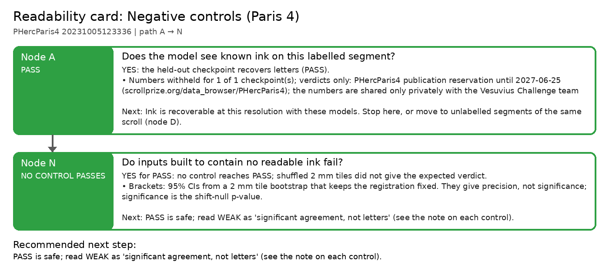

# Readability card: Negative controls (Paris 4)

**Scroll / segment:** PHercParis4 20231005123336
**Verdict path:** A → N  
**Bottom line:** No negative control PASSes. Wrong region, phase-randomised and shuffled+rotated tiles FAIL as expected; plain tile shuffle is WEAK (the text-line layout survives a shuffle, so r stays significant) but its stroke recall is at chance, so the letter-level test blocks PASS.  
**Recommended next step:** PASS is safe; read WEAK as 'significant agreement, not letters' (see the note on each control).

Same segment, same model (dense_native 16k) and same reference as the Paris 4 PASS, but with the link between prediction and reference destroyed in four ways: reference from another region of the scroll (wrong region), prediction with Fourier phases randomised (same spectrum, no letters), reference cut into 2 mm tiles and shuffled, and shuffled tiles additionally rotated 90/270° with no tile left in place. Scripts: results/negctrl/make_controls.py, make_controls_b.py, run_controls.sh.

## Node A: Does the model see known ink on this labelled segment?

**PASS**: YES: the held-out checkpoint recovers letters (PASS).

- Numbers withheld for 1 of 1 checkpoint(s); verdicts only: PHercParis4 publication reservation until 2027-06-25 (scrollprize.org/data_browser/PHercParis4); the numbers are shared only privately with the Vesuvius Challenge team
- Held-out checkpoints: 1 PASS, 0 WEAK, 0 FAIL (numbers withheld).

| checkpoint | verdict | r_bp [95% CI] (z) | AUC (published) | stroke recall [95% CI] (chance) | strokes | note |
|---|---|---|---|---|---|---|
| positive: dense_native vs true reference | PASS | withheld | withheld | withheld | withheld |  |

*Next:* Ink is recoverable at this resolution with these models. Stop here, or move to unlabelled segments of the same scroll (node D).  
*Automation:* automatic.

## Node N: Do inputs built to contain no readable ink fail?

**NO_CONTROL_PASSES**: YES for PASS: no control reaches PASS; shuffled 2 mm tiles did not give the expected verdict.

- Brackets: 95% CIs from a 2 mm tile bootstrap that keeps the registration fixed. They give precision, not significance; significance is the shift-null p-value.
- 3 of 4 controls give the expected verdict; 0 PASS.

| checkpoint | verdict | r_bp [95% CI] (z) | AUC (published) | stroke recall [95% CI] (chance) | strokes | note |
|---|---|---|---|---|---|---|
| wrong region | FAIL | 0.048 [0.01, 0.08] (-0.2) | 0.581 | 0.10 [0.00, 0.22] (0.10) | 51 | expected FAIL: reproduced |
| phase-randomised prediction | FAIL | 0.097 [0.03, 0.17] (1.0) | 0.610 | 0.04 [0.00, 0.14] (0.06) | 26 | expected FAIL: reproduced |
| shuffled 2 mm tiles | WEAK | 0.152 [0.06, 0.25] (5.1) | 0.559 | 0.17 [0.05, 0.30] (0.08) | 42 | expected FAIL: NOT reproduced; line layout survives the shuffle (1 tile in place); recall − chance CI includes 0 |
| shuffled + rotated tiles | FAIL | 0.102 [0.01, 0.21] (3.0) | 0.576 | 0.18 [0.08, 0.31] (0.11) | 44 | expected FAIL: reproduced; no tile in place, rotated 90/270° |

*Next:* PASS is safe; read WEAK as 'significant agreement, not letters' (see the note on each control).  
*Automation:* automatic.

---
Generated by `inkcheck report` (Ink Recoverability Protocol, CPU-only). Verdict rules: README → 'The protocol'.
