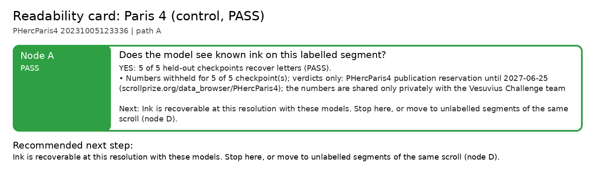

# Readability card: Paris 4 (control, PASS)

**Scroll / segment:** PHercParis4 20231005123336
**Verdict path:** A  
**Bottom line:** YES: 5 of 5 held-out checkpoints recover letters (PASS).  
**Recommended next step:** Ink is recoverable at this resolution with these models. Stop here, or move to unlabelled segments of the same scroll (node D).

Held-out Paris 4 segment, 9.6 µm input pooled from the 2.4 µm scan, reference new_canon at 19.2 µm. Five public ~9 µm checkpoints, including Reader v2 and V3.

## Node A: Does the model see known ink on this labelled segment?

**PASS**: YES: 5 of 5 held-out checkpoints recover letters (PASS).

- Numbers withheld for 5 of 5 checkpoint(s); verdicts only: PHercParis4 publication reservation until 2027-06-25 (scrollprize.org/data_browser/PHercParis4); the numbers are shared only privately with the Vesuvius Challenge team
- Held-out checkpoints: 5 PASS, 0 WEAK, 0 FAIL (numbers withheld).

| checkpoint | verdict | r_bp [95% CI] (z) | AUC (published) | stroke recall [95% CI] (chance) | strokes | note |
|---|---|---|---|---|---|---|
| Reader v2 | PASS | withheld | withheld | withheld | withheld |  |
| Reader V3 | PASS | withheld | withheld | withheld | withheld |  |
| d9v4C | PASS | withheld | withheld | withheld | withheld |  |
| ink_9um seed42 | PASS | withheld | withheld | withheld | withheld |  |
| dense_native 16k | PASS | withheld | withheld | withheld | withheld |  |

*Next:* Ink is recoverable at this resolution with these models. Stop here, or move to unlabelled segments of the same scroll (node D).  
*Automation:* automatic.

---
Generated by `inkcheck report` (Ink Recoverability Protocol, CPU-only). Verdict rules: README → 'The protocol'.
