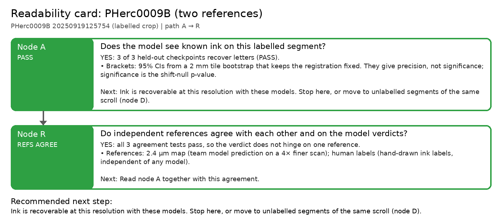

# Readability card: PHerc0009B (two references)

**Scroll / segment:** PHerc0009B 20250919125754 (labelled crop)
**Verdict path:** A → R  
**Bottom line:** Three held-out checkpoints read letters on a 0009B segment: Reader V3 (r 0.79, stroke recall 0.59 vs 0.17 chance), Reader v2 (r 0.75, 0.59) and dense_native (r 0.67, 0.54), and the independent human labels agree for all three (r 0.69 / 0.65 / 0.58, 10 of 10 strokes): PASS on two references.  
**Recommended next step:** Ink is recoverable at this resolution with these models. Stop here, or move to unlabelled segments of the same scroll (node D).

Native 8.64 µm / 116 keV surface volume; Reader V3, Reader v2 and Erwin Nieuwlaar's dense_native 16k (trained on the ink_9um labels: PHerc0139, 1667, Paris 4, 0814, so no 0009B). Two references: the team's 2.4 µm ink map and the human ink labels (level 4, 9.6 µm, labelled area only). Segment 20250919125754 is not in Reader V3's training list (checked in the configs embedded in reader-v3.pth and reader-v2-step040000.pth); other 0009B segments are, so this is a held-out segment of a seen scroll.

## Node A: Does the model see known ink on this labelled segment?

**PASS**: YES: 3 of 3 held-out checkpoints recover letters (PASS).

- Brackets: 95% CIs from a 2 mm tile bootstrap that keeps the registration fixed. They give precision, not significance; significance is the shift-null p-value.
- Held-out checkpoints: 3 PASS, 0 WEAK, 0 FAIL (best: Reader V3 vs 2.4 µm map, r_bp 0.79, stroke recall 0.59 vs chance 0.17; recall − chance +0.42, 95% CI [+0.27, +0.56]).

| checkpoint | verdict | r_bp [95% CI] (z) | AUC (published) | stroke recall [95% CI] (chance) | strokes | note |
|---|---|---|---|---|---|---|
| Reader V3 vs 2.4 µm map | PASS | 0.790 [0.76, 0.82] (36.7) | 0.962 | 0.59 [0.44, 0.74] (0.17) | 54 |  |
| dense_native 16k vs 2.4 µm map | PASS | 0.670 [0.63, 0.71] (32.4) | 0.918 | 0.54 [0.39, 0.69] (0.15) | 54 |  |
| Reader v2 vs 2.4 µm map | PASS | 0.754 [0.72, 0.79] (36.9) | 0.948 | 0.59 [0.45, 0.73] (0.16) | 54 |  |

*Next:* Ink is recoverable at this resolution with these models. Stop here, or move to unlabelled segments of the same scroll (node D).  
*Automation:* automatic.

## Node R: Do independent references agree with each other and on the model verdicts?

**REFS_AGREE**: YES: all 3 agreement tests pass, so the verdict does not hinge on one reference.

- References: **2.4 µm map** (team model prediction on a 4× finer scan); **human labels** (hand-drawn ink labels, independent of any model).
- Same prediction scored against each reference; 'same decision' = both PASS or both not PASS.

| comparison | reference A | reference B | agreement |
|---|---|---|---|
| Reader V3 (same prediction) | PASS (r 0.79, recall 0.59, 54 strokes) | PASS (r 0.69, recall 1.00, 10 strokes) | same decision |
| dense_native 16k (same prediction) | PASS (r 0.67, recall 0.54, 54 strokes) | PASS (r 0.58, recall 1.00, 10 strokes) | same decision |
| Reader v2 (same prediction) | PASS (r 0.75, recall 0.59, 54 strokes) | PASS (r 0.65, recall 1.00, 10 strokes) | same decision |

*Next:* Read node A together with this agreement.  
*Automation:* automatic.

---
Generated by `inkcheck report` (Ink Recoverability Protocol, CPU-only). Verdict rules: README → 'The protocol'.
