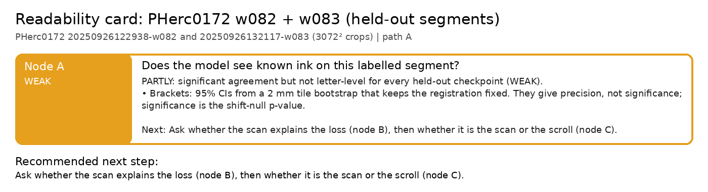

# Readability card: PHerc0172 w082 + w083 (held-out segments)

**Scroll / segment:** PHerc0172 20250926122938-w082 and 20250926132117-w083 (3072² crops)
**Verdict path:** A  
**Bottom line:** Three held-out checkpoints see 0172 ink but not letters on two segments: Reader V3 (r 0.45 / 0.51, stroke recall 0.35 / 0.36 vs 0.20 / 0.19 chance), Reader v2 (r 0.47 / 0.50, 0.37 / 0.35) and dense_native (r 0.34 / 0.26, 0.23 / 0.21): WEAK.  
**Recommended next step:** Ask whether the scan explains the loss (node B), then whether it is the scan or the scroll (node C).

Native 7.91 µm / 53 keV surface volumes; Reader V3, Reader v2 and dense_native 16k. Reference: the team's ink-detection map published with each segment on the open-data bucket (a model prediction on the same scan, not ground truth). Segments w082 and w083 are not in Reader V3's or Reader v2's training list; four other 0172 segments are (checked in the configs embedded in reader-v3.pth and reader-v2-step040000.pth). dense_native 16k is also held out here (the ink_9um labels contain no PHerc0172).

## Node A: Does the model see known ink on this labelled segment?

**WEAK**: PARTLY: significant agreement but not letter-level for every held-out checkpoint (WEAK).

- Brackets: 95% CIs from a 2 mm tile bootstrap that keeps the registration fixed. They give precision, not significance; significance is the shift-null p-value.
- Held-out checkpoints: 0 PASS, 6 WEAK, 0 FAIL (best: Reader V3 vs team map, w083, r_bp 0.51, stroke recall 0.36 vs chance 0.19; recall − chance +0.16, 95% CI [+0.10, +0.23]).

| checkpoint | verdict | r_bp [95% CI] (z) | AUC (published) | stroke recall [95% CI] (chance) | strokes | note |
|---|---|---|---|---|---|---|
| Reader V3 vs team map, w082 | WEAK | 0.452 [0.41, 0.49] (32.4) | 0.842 | 0.35 [0.29, 0.41] (0.20) | 231 |  |
| Reader v2 vs team map, w082 | WEAK | 0.473 [0.43, 0.51] (36.4) | 0.840 | 0.37 [0.31, 0.43] (0.20) | 231 |  |
| dense_native 16k vs team map, w082 | WEAK | 0.336 [0.29, 0.38] (25.9) | 0.748 | 0.23 [0.17, 0.28] (0.18) | 231 |  |
| Reader V3 vs team map, w083 | WEAK | 0.508 [0.48, 0.54] (40.1) | 0.839 | 0.36 [0.29, 0.42] (0.19) | 232 |  |
| Reader v2 vs team map, w083 | WEAK | 0.502 [0.47, 0.53] (43.7) | 0.825 | 0.35 [0.29, 0.41] (0.18) | 232 |  |
| dense_native 16k vs team map, w083 | WEAK | 0.260 [0.22, 0.30] (22.1) | 0.680 | 0.21 [0.16, 0.26] (0.16) | 233 |  |

*Next:* Ask whether the scan explains the loss (node B), then whether it is the scan or the scroll (node C).  
*Automation:* automatic.

---
Generated by `inkcheck report` (Ink Recoverability Protocol, CPU-only). Verdict rules: README → 'The protocol'.
