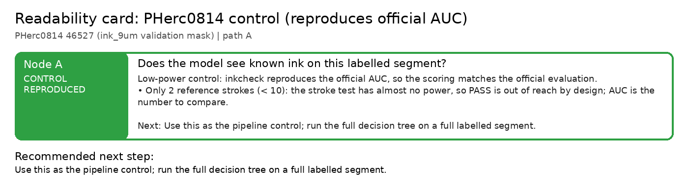

# Readability card: PHerc0814 control (reproduces official AUC)

**Scroll / segment:** PHerc0814 46527 (ink_9um validation mask)
**Verdict path:** A  
**Bottom line:** Low-power control: inkcheck reproduces the official AUC, so the scoring matches the official evaluation.  
**Recommended next step:** Use this as the pipeline control; run the full decision tree on a full labelled segment.

Same crop and held-out pixels as the official ink_9um validation mask (bench/fetch_ink9um_val.py), villa inference on CPU. Published AUCs from the checkpoints' own evaluations.

## Node A: Does the model see known ink on this labelled segment?

**CONTROL_REPRODUCED**: Low-power control: inkcheck reproduces the official AUC, so the scoring matches the official evaluation.

- Only 2 reference strokes (< 10): the stroke test has almost no power, so PASS is out of reach by design; AUC is the number to compare.
- AUC reproduces the published value (|Δ| ≤ 0.02) for 4 of 4 checkpoints with a published AUC: dense9um all7 0.939 vs 0.935, dense9um w016-excluded 0.930 vs 0.930, ink_9um seed42 75k 0.884 vs 0.874, Erwin soup42_last4 0.870 vs 0.881.

| checkpoint | verdict | r_bp [95% CI] (z) | AUC (published) | stroke recall [95% CI] (chance) | strokes | note |
|---|---|---|---|---|---|---|
| Erwin dense_native 16k | WEAK | 0.658 (7.3) | 0.932 | 1.00 (0.43) | 2 |  |
| dense9um all7 | WEAK | 0.667 (7.4) | 0.939 (0.935) | 1.00 (0.40) | 2 |  |
| dense9um w016-excluded | WEAK | 0.645 (6.2) | 0.930 (0.930) | 1.00 (0.41) | 2 |  |
| ink_9um seed42 75k | WEAK | 0.581 (5.8) | 0.884 (0.874) | 1.00 (0.53) | 2 |  |
| ink_9um seed43 75k | WEAK | 0.495 (2.4) | 0.858 | 0.50 (0.62) | 2 |  |
| Erwin soup42_last4 | WEAK | 0.566 (5.1) | 0.870 (0.881) | 1.00 (0.50) | 2 |  |

*Next:* Use this as the pipeline control; run the full decision tree on a full labelled segment.  
*Automation:* automatic.

---
Generated by `inkcheck report` (Ink Recoverability Protocol, CPU-only). Verdict rules: README → 'The protocol'.
