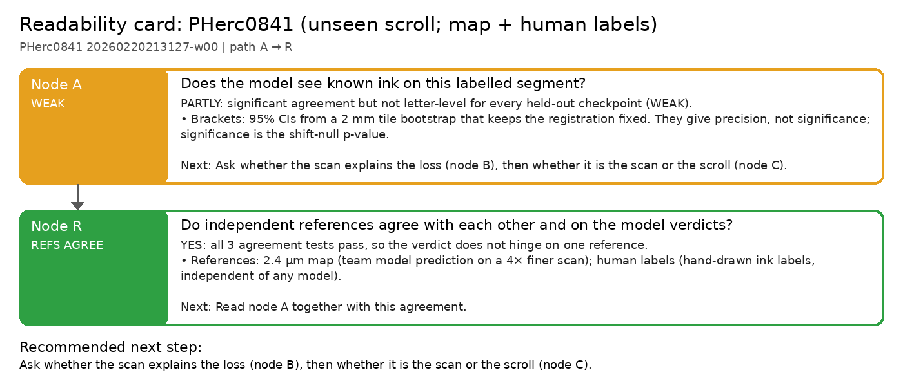

# Readability card: PHerc0841 (unseen scroll; map + human labels)

**Scroll / segment:** PHerc0841 20260220213127-w00
**Verdict path:** A → R  
**Bottom line:** Reader V3, Reader v2 and dense_native all see 0841 ink (significant against the 2.4 µm map and the human labels) but not at letter level (WEAK: best stroke recall 0.34 vs 0.15 chance), on a scroll none of them trained on.  
**Recommended next step:** Ask whether the scan explains the loss (node B), then whether it is the scan or the scroll (node C).

Native 9.37 µm / 113 keV surface volume; Reader V3, Reader v2 and dense_native 16k (the ink_9um labels contain no PHerc0841). Two references: the team's 2.4 µm ink map (117 strokes, used for node A) and the human ink labels (level 4, 9.6 µm; independent of any model, but they merge into only 7 connected strokes, too few for a letter-level verdict on their own). No PHerc0841 segment is in Reader V3's or Reader v2's training list (checked in the configs embedded in reader-v3.pth and reader-v2-step040000.pth): an unseen scroll.

## Node A: Does the model see known ink on this labelled segment?

**WEAK**: PARTLY: significant agreement but not letter-level for every held-out checkpoint (WEAK).

- Brackets: 95% CIs from a 2 mm tile bootstrap that keeps the registration fixed. They give precision, not significance; significance is the shift-null p-value.
- Held-out checkpoints: 0 PASS, 3 WEAK, 0 FAIL (best: Reader V3 vs 2.4 µm map, r_bp 0.55, stroke recall 0.34 vs chance 0.15; recall − chance +0.19, 95% CI [+0.11, +0.29]).

| checkpoint | verdict | r_bp [95% CI] (z) | AUC (published) | stroke recall [95% CI] (chance) | strokes | note |
|---|---|---|---|---|---|---|
| Reader V3 vs 2.4 µm map | WEAK | 0.547 [0.49, 0.59] (41.4) | 0.855 | 0.34 [0.25, 0.44] (0.15) | 117 |  |
| dense_native 16k vs 2.4 µm map | WEAK | 0.391 [0.34, 0.44] (29.3) | 0.794 | 0.25 [0.17, 0.33] (0.12) | 118 |  |
| Reader v2 vs 2.4 µm map | WEAK | 0.511 [0.45, 0.56] (38.1) | 0.839 | 0.31 [0.23, 0.40] (0.13) | 118 |  |

*Next:* Ask whether the scan explains the loss (node B), then whether it is the scan or the scroll (node C).  
*Automation:* automatic.

## Node R: Do independent references agree with each other and on the model verdicts?

**REFS_AGREE**: YES: all 3 agreement tests pass, so the verdict does not hinge on one reference.

- References: **2.4 µm map** (team model prediction on a 4× finer scan); **human labels** (hand-drawn ink labels, independent of any model).
- Same prediction scored against each reference; 'same decision' = both PASS or both not PASS.

| comparison | reference A | reference B | agreement |
|---|---|---|---|
| Reader V3 (same prediction) | WEAK (r 0.55, recall 0.34, 117 strokes) | WEAK (r 0.30, recall 0.00, 7 strokes) | same decision |
| dense_native 16k (same prediction) | WEAK (r 0.39, recall 0.25, 118 strokes) | WEAK (r 0.18, recall 0.00, 7 strokes) | same decision |
| Reader v2 (same prediction) | WEAK (r 0.51, recall 0.31, 118 strokes) | WEAK (r 0.23, recall 0.14, 7 strokes) | same decision |

*Next:* Read node A together with this agreement.  
*Automation:* automatic.

---
Generated by `inkcheck report` (Ink Recoverability Protocol, CPU-only). Verdict rules: README → 'The protocol'.
