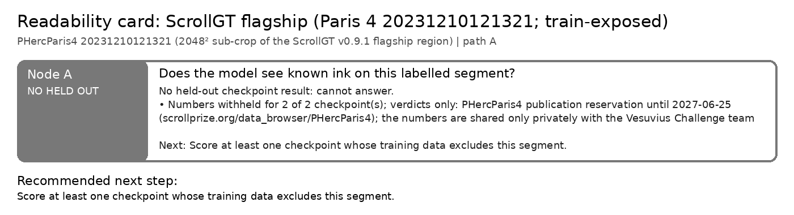

# Readability card: ScrollGT flagship (Paris 4 20231210121321; train-exposed)

**Scroll / segment:** PHercParis4 20231210121321 (2048² sub-crop of the ScrollGT v0.9.1 flagship region)
**Verdict path:** A  
**Bottom line:** Both checkpoints PASS against ScrollGT's human label, but the segment is in their training data, so IRP excludes them: NO_HELD_OUT. The leakage guard works as intended. (Paris 4 numbers withheld: data reservation until 2027-06-25.)  
**Recommended next step:** Score at least one checkpoint whose training data excludes this segment.

ScrollGT (MIT, v0.9.1, commit 0f3fa90) ships a registered human ink label for this segment and calls it its held-out flagship. It is held out from ScrollGT's own baselines, but not from ours: 20231210121321 is ink_9um's phercparis4-w06, which is listed in the training configs embedded in Reader V3 and ink_9um seed42 (and dense_native). Input: level-2 (9.6 µm) surface volume, 4× z-pooled, layers 5-21; reference: ScrollGT's gt_ink.png binarised at > 127, cropped to the same box (examples/scrollgt/fetch_flagship.py). examples/scrollgt/ap_lift.py computes AP-prevalence-lift (ScrollGT's primary metric) on this crop. This segment is part of PHercParis4, so the scores (inkcheck numbers and AP-lift) are not published here while the publication reservation (until 2027-06-25) applies; only the verdicts are shown.

## Node A: Does the model see known ink on this labelled segment?

**NO_HELD_OUT**: No held-out checkpoint result: cannot answer.

- Numbers withheld for 2 of 2 checkpoint(s); verdicts only: PHercParis4 publication reservation until 2027-06-25 (scrollprize.org/data_browser/PHercParis4); the numbers are shared only privately with the Vesuvius Challenge team

| checkpoint | verdict | r_bp [95% CI] (z) | AUC (published) | stroke recall [95% CI] (chance) | strokes | note |
|---|---|---|---|---|---|---|
| Reader V3 vs ScrollGT label | PASS | withheld | withheld | withheld | withheld | NOT held out; segment = ink_9um phercparis4-w06, in Reader V3's training config |
| ink_9um seed42 vs ScrollGT label | PASS | withheld | withheld | withheld | withheld | NOT held out; segment = phercparis4-w06, in seed42's training config |

*Next:* Score at least one checkpoint whose training data excludes this segment.  
*Automation:* automatic.

---
Generated by `inkcheck report` (Ink Recoverability Protocol, CPU-only). Verdict rules: README → 'The protocol'.
